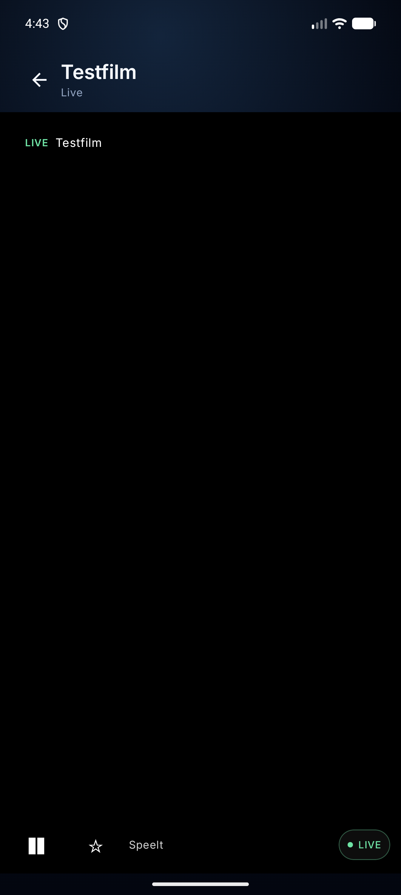
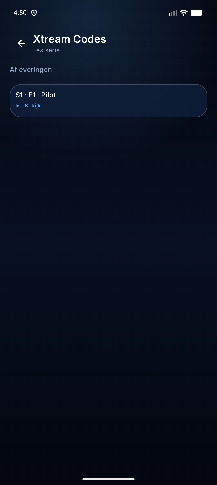
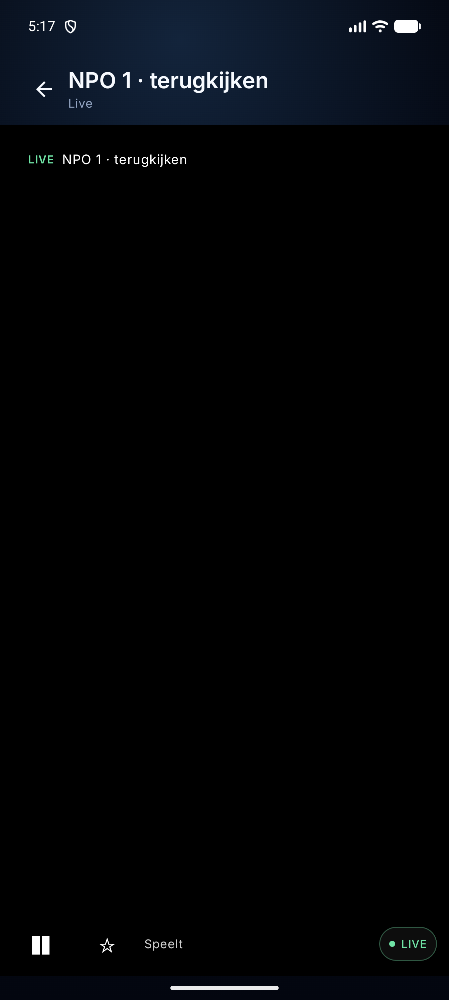

# Live, IPTV en bibliotheek op de telefoon

De Companion-app speelt vanaf fase 5 zelf video af. Dat gaat **niet** via de TV-brug: de
telefoon praat rechtstreeks met de Enigma2-ontvanger of de IPTV-provider. De brug blijft
voor afstandsbediening, formulieren, instellingen, profielen en foto's.

## Enigma2 (fase 5)

- Instellingen: host, webif-poort (80), streampoort (8001), optionele gebruikersnaam/
  wachtwoord en HTTPS. Het wachtwoord gaat via `SecureStore` (AES-GCM/Keystore); de rest
  staat in `SharedPreferences`.
- Zenderlijsten: `GET /api/bouquets`, `GET /api/getservices?sRef=...` en
  `GET /api/epgnow?bRef=...` via dezelfde `OpenWebifEndpoints`/`OpenWebifJson` als de TV.
- Stream: `http://host:streampoort/<serviceReference>`; bij streamauthenticatie wordt
  `Authorization: Basic ...` meegestuurd (dezelfde header als de TV).
- Speler: Media3 ExoPlayer met `DefaultHttpDataSource` (headers, cross-protocol
  redirects) en `PlayerSurface`. MPEG-TS en HLS (via `media3-exoplayer-hls`).
- De telefoon hoeft niet gekoppeld te zijn aan de TV en de TV hoeft niet aan te staan.
- **Recent op de tv:** de TV stuurt `state.recent` met `ChannelMemory.recentFor` van de
  actieve ontvanger; de telefoon toont die zenders boven de bouquetten en speelt ze via
  zijn eigen OpenWebif-stream. De referenties moeten op dezelfde ontvanger geldig zijn;
  bij een andere ontvanger kan de stream mislukken.
- **Speler:** opent automatisch in **landscape** en **fullscreen** (systeembalken
  verborgen, decor fit uit, cutout kort). De surface krijgt de beeldverhouding van
  `VideoSize` (`width * pixelWidthHeightRatio / height`) en wordt gecentreerd met zwarte
  balken; bij terugkeren wordt de oorspronkelijke oriëntatie en systeembalk hersteld.
- **Zenderlijst:** bij live-IPTV staat links een overlay met de huidige categorie
  (`PlayerChannel`), logo, naam en selectie. De lijst is scrollbaar en toont in landscape
  ongeveer zes tot acht zenders; tikken wisselt direct van stream. De menu-knop verbergt
  de lijst en de onderbalk schuift dan terug naar de volledige breedte.
- **TMDB:** films en series openen een infodialoog met poster, jaar, score en
  beschrijving. De titel wordt genormaliseerd (`EN - The Gentleman (2025)` → `The
  Gentleman`) en alleen een exacte titelmatch levert TMDB-info; anders blijft de
  providerinformatie staan.

### Testen zonder ontvanger

`tools/fake-live.py` start:

- `:8090` — fake OpenWebif (`/api/bouquets`, `/api/getservices`, `/api/epgnow`);
- `:8081` — een 60 s WAV-stream (voor de speler; op een echte ontvanger is dit video);
- `:8092` — M3U-playlist;
- `:8093` — fake Xtream (`player_api.php`, live-streams).

```powershell
python tools/fake-live.py
adb -s emulator-5556 reverse tcp:8090 tcp:8090
adb -s emulator-5556 reverse tcp:8081 tcp:8081
adb -s emulator-5556 reverse tcp:8092 tcp:8092
adb -s emulator-5556 reverse tcp:8093 tcp:8093
```

In de app: **Live → Demo-ontvanger (lokaal)**, **IPTV → Demo**, **Xtream Codes-login →
Demo-Xtream**. De demo-knoppen zijn alleen voor diagnose en zetten `127.0.0.1`-adressen.

## IPTV (fase 6)

De telefoon krijgt de IPTV-bron bij voorkeur automatisch van de TV (`state.iptv`): de TV
leest de M3U/Xtream-login uit zijn playliststore of vraagt hem bij de sync-server op en
stuurt hem over de gekoppelde WSS. De telefoon bewaart de M3U-URL en Xtream-wachtwoorden
versleuteld en logt automatisch in. Handmatig een playlist of Xtream-server invoeren blijft
als fallback.

- **M3U:** een playlistadres wordt geladen en met `M3uParser` (dezelfde parser als de TV)
  geparseerd; groepen komen uit `group-title`. `User-Agent`/`Referer` uit de playlist gaan
  mee naar de speler.
- **Xtream Codes:** server + gebruikersnaam/wachtwoord; `player_api.php` met
  `get_live_categories`/`get_live_streams`, `get_vod_categories`/`get_vod_streams` en
  `get_series_categories`/`get_series`/`get_series_info`. De app heeft de secties **Live**,
  **Films** en **Series**; een serie opent de afleveringen. Streams:
  `/live/<user>/<pass>/<id>.ts`, `/movie/.../<id>.<ext>` en `/series/.../<id>.<ext>`.
  Wachtwoord in de Keystore.
- **Catch-up met EPG:** bij een live-zender met `tv_archive`/`catchup-source` opent
  **"Terugkijken"** de programma's uit `get_short_epg` die binnen het archief vallen
  (`Catchup.canPlay`). Een programma kiezen speelt de timeshift-URL
  (`/timeshift/...` of de M3U-template).





## Bibliotheek (fase 7)

- `LibraryStore` bewaart per URL: titel, positie, duur, bron (`live`/`iptv`), favoriet en
  tijdstip. Max. 100 items, JSON in `SecureStore` (AES-GCM/Keystore), omdat IPTV-URL's
  inloggegevens kunnen bevatten.
- De speler schrijft elke 5 s en bij het sluiten de positie; de ster maakt een favoriet.
- "Verder kijken" toont items met een positie tussen 5 s en het einde; "Favorieten" en
  "Recent" staan eronder.
- Profielen, instellingen en **IPTV-favorieten/-voortgang** synchroniseren via de
  Companion-brug. De TV stuurt `state.library` (favorieten + posities van het actieve
  profiel); de telefoon schrijft een ster of positie terug met `cmd.library`. De TV gebruikt
  daarbij dezelfde `IptvLibrary` als zijn eigen Library.
- Live/Enigma2-geschiedenis en IPTV-items zonder TV-record blijven lokaal.

- **Afspeelfout?** De speler gebruikt decoder-fallback; op de emulator kan een High-profile
  H.264-testbestand alsnog `ERROR_CODE_DECODING_FAILED` geven. Op een echte telefoon met
  hardware-decoder is dat niet de verwachte route.

## Beperkingen

- **Video op een fysieke ontvanger/provider is niet getest**; de emulator-test gebruikt
  een audiostream om de volledige keten (lijst → EPG → speler) te bewijzen.
- **Cleartext HTTP** is toegestaan voor LAN-ontvangers (`usesCleartextTraffic="true"`);
  gebruik HTTPS waar de ontvanger dat ondersteunt.
- De bibliotheek bewaart **geen** auth-headers; een met auth beveiligde Enigma2-stream
  kan na herstart niet hervatten.
- IPTV-catch-up met EPG werkt; oudere programma's buiten het archiefvenster worden
  verborgen.
- De TV-sync geldt voor IPTV-records van het **actieve TV-profiel**; live/Enigma2 volgt.
