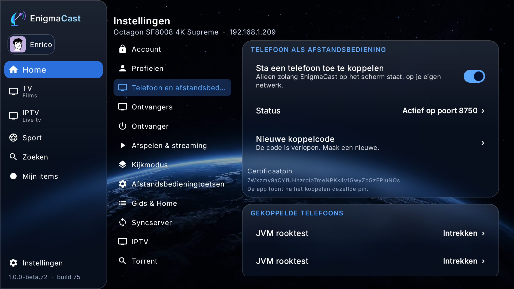
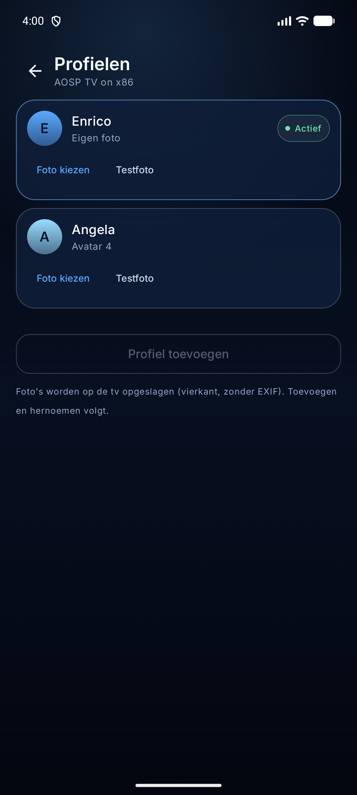
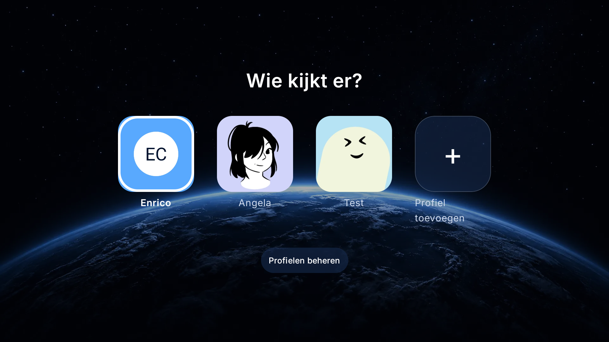

# TV-brug in EnigmaCast (fase 2)

Status: **geïmplementeerd en end-to-end getest** op een Android TV-emulator (API 36).
De Companion-telefoon gebruikt nog de mock; het protocol is aan beide kanten bewezen.

## Waar de code staat



Alles staat in de EnigmaCast-repo onder
`app/src/main/java/com/enigmacast/companionbridge/`:

| Bestand | Taak |
|---|---|
| `CompanionBridge.kt` | Singleton: lifecycle, toestand, commando's, hooks |
| `CompanionServer.kt` | HTTPS + WSS op één poort (raw sockets, geen framework) |
| `CompanionTls.kt` | Zelfondertekend certificaat uit de Android Keystore + pin |
| `CompanionWebSocket.kt` | RFC 6455-frames en de accept-key |
| `CompanionAuth.kt` | Getekende requests, nonce, klokvenster |
| `CompanionDevices.kt` | Koppellijst (publieke sleutel + tokenhash) |
| `CompanionPairing.kt` | Eenmalige 6-cijferige code, 120 s |
| `CompanionProtocol.kt` | Protocol v1 (envelope, types, JSON) |
| `CompanionHooks.kt` | De vier hooks die MainActivity zet |
| `ui/CompanionLinkPanel.kt` | Settings › Phone & remote |
| `ui/CompanionViewModel.kt` | Hilt-viewmodel voor het paneel |

## Aansluitpunten in de bestaande app

| Bestand | Wijziging |
|---|---|
| `app/build.gradle.kts` | `buildConfigField("boolean", "COMPANION_BRIDGE", "true")` |
| `MainActivity.kt` | Injectie, hooks, `onForeground`/`onBackground`/`shutdown` |
| `ui/dashboard/DashboardScreen.kt` | `SettingPage.Companion`, één menu-regel, één `when`-tak |
| `res/values/strings.xml`, `res/values-nl/strings.xml` | 22 strings |
| nieuw package + test | de brug zelf |

Geen nieuwe dependency, geen manifestwijziging, geen service. De brug is met de
BuildConfig-flag uit te zetten; verwijderen = package + vier regels terugdraaien.

## Werking

```text
Telefoon ──TLS 1.2/1.3, SPKI-pin──► 0.0.0.0:8750
                                   ├─ GET  /api/v1/health   (geen auth)
                                   ├─ POST /api/v1/pair     (code + publieke sleutel)
                                   ├─ GET  /api/v1/info     (auth)
                                   └─ GET  /ws              (auth, daarna frames)
```

- **TLS**: EC P-256 in de Android Keystore; het certificaat wordt door de Keystore
  gemaakt (API 26+). De sleutel staat `DIGEST_NONE` toe, omdat Conscrypt de
  handshake met een raw digest ondertekent. Zonder die digest faalt de handshake
  met `KeyStoreException: Incompatible digest`.
- **Koppelen**: 6 cijfers, 120 s, eenmalig, 5 pogingen per 5 min per IP. De telefoon
  stuurt zijn SPKI; de TV bewaart alleen de publieke sleutel en `SHA-256(token)`.
- **Auth**: elk request na het koppelen is ECDSA-ondertekend over
  `timestamp \n nonce \n METHOD \n path \n SHA-256(body)`, met 120 s klokvenster
  en een nonce-tabel. De WebSocket-upgrade is een getekend `GET /ws`.
- **Status**: bij verbinden `hello` (seq 0) + `state.player` (seq 1); daarna bij elke
  wijziging een nieuw `state.player` met oplopende `seq`.
- **Commando's**: `cmd.key` (D-pad, OK, Back, Menu, media, kleur, cijfers),
  `cmd.nav`, `cmd.zap`, `cmd.volume`, `cmd.player`, `cmd.profile`, `cmd.power`,
  `cmd.sync`. Toetsen gaan als echte `KeyEvent`s naar `Activity.dispatchKeyEvent`,
  zodat de bestaande focus-, herhaal- en long-presslogica ongewijzigd geldt.
- **Lifecycle**: alleen op de voorgrond (ADR 0006). `onStart` start, `onStop` stopt
  na 30 s, `onDestroy` (bij afsluiten) stopt direct.

## Getest

| Test | Resultaat |
|---|---|
| TV-unit tests | **189 klassen, 929 tests, 0 failures** (6 nieuwe brugtests) |
| Companion-suite | **125 klassen, 667 tests, 0 failures, 1 optionele rooktest overgeslagen** |
| `websocketAcceptKeyMatchesTheRfcExample` | RFC 6455-vector |
| `canonicalSignatureIsStable` | zelfde bytes als de Companion-client |
| `formCapabilityAndTypesMatchTheCompanion` | `text.form`, `form`, `cmd.form` |
| End-to-end op emulator (API 36) | health 200, pair 200, pin gelijk, WS 101, hello, state, ack 2 ms |
| Echte telefoon ↔ TV (twee emulators) | pair, WSS verbonden, `CHANNEL_UP` **0 ms**, TV zag "1 telefoon(s) verbonden" |
| Formulier (twee emulators) | TV-zoekveld ← telefoon "test" live; `SUBMIT` sluit; `closed=true` |
| Instellingen (twee emulators) | `navigationSounds` aan/uit vanaf de telefoon; catalogus kwam terug met de nieuwe waarde |
| Profielfoto (twee emulators) | getekende `PUT`; TV toonde de "EC"-foto op Enrico; telefoon "Eigen foto"; `state.profiles` zonder crash |
| Profiel-CRUD (twee emulators) | "Test" aangemaakt, hernoemd naar "Test2", avatar 7, verwijderd; TV-lijst volgde |
| Foto wissen (twee emulators) | "Foto wissen" → "Avatar 7"; daarna opnieuw uploaden → "Eigen foto" |
| Gevorderde instelling | HDMI-passthrough gaf de bevestigingsdialoog; geannuleerd |
| Gedeelde bibliotheek (twee emulators) | Testfilm op de telefoon → `iptv_resume` (18 s/60 s) en `iptv_library` op de TV voor het actieve profiel |
| Herverbinden | TV geforceerd gestopt → Offline; herstart → automatisch weer Verbonden |

Bewijs uit de rooktest:

```text
health: 200 {"ok":true,"service":"enigmacast-companion","api":"v1",
             "tvId":"ec-3e5c85280607055c","name":"AOSP TV on x86","pairing":true}
pair:   200 {"deviceId":"31606e13-…","token":"KLFrehDx…","role":"member", …}
pin:    7Wxzmy9aQYfUHhzroloTmeNPKk4v1GwyZcGzEPluNOs   (gelijk aan de TV)
ws:     HTTP/1.1 101 Switching Protocols
hello:  {"v":1,"seq":0,"type":"hello", …}
state:  {"v":1,"seq":1,"type":"state.player","payload":{"source":"idle",
         "now":{"title":"Renze", …,"nextTitle":"LUBACH", …}}}
ack:    {"v":1,"id":"t1","type":"ack","payload":{"ok":true,"latencyMs":2}}
```

Reproduceren:

```powershell
adb -s <tv> forward tcp:8750 tcp:8750
adb -s <tv> shell am start -n com.enigmacast.app/com.enigmacast.MainActivity
# Settings › Phone & remote › aan; lees de code en de pin
$env:BRIDGE_CODE="123456"; $env:BRIDGE_PIN="<pin>"
.\gradlew.bat :tools:tls-spike:test --tests "*BridgeSmokeTest*" --offline
```

Zonder echte ontvanger (voor de wizard/het dashboard op een emulator):

```powershell
python tools/fake-openwebif.py 8081
adb -s <tv> reverse tcp:8080 tcp:8081
# in de app: host 127.0.0.1, poort 8080, streampoort 8001 (plus reverse tcp:8001 tcp:8001)
```

## Formulieren (fase 3)

`TvTextField` is de enige plek waar de TV tekst invoert. Zodra een veld in bewerken gaat,
opent `CompanionFormHost` een sessie en stuurt de brug een `form`-event. De Companion toont
een toetsenbord-sheet; elke toets gaat als `cmd.form TEXT` terug en de TV past de waarde
live toe. `Klaar` stuurt `SUBMIT`, `Annuleren` `CANCEL`; de TV sluit de sessie ook als de
focus van het veld weggaat.

**Meerveldsformulier:** de ontvanger-setup heeft **"Vul via telefoon"**. Die opent host,
gebruikersnaam en wachtwoord in één sessie; de telefoon toont drie velden, `TEXT` stuurt
alleen de zichtbare velden en `SUBMIT` past ze in één keer toe. Het wachtwoord blijft leeg
betekenen "niet gewijzigd". De host/DTO/telefoon zijn gecompileerd; de setup-pagina was op
de emulator niet bereikbaar voor een volledige E2E.

- **TV:** `CompanionFormHost.kt` (sessie + main-thread-callback), `CompanionFormHub.kt`
  (haak voor de UI), `TvTextField.kt` (openen/sluiten/synchroniseren).
- **Telefoon:** `FormSheet.kt` (generiek veld + toetsenbord), `AppViewModel` (`formValues`,
  `TEXT`/`SUBMIT`/`CANCEL`).
- **Wachtwoorden:** `masked`/`sensitive`; de descriptor bevat geen waarde en de logs
  bevatten alleen formId en label. Live `TEXT` gaat alleen voor niet-gevoelige velden;
  een leeg `SUBMIT` laat het bestaande wachtwoord staan.
- **Demo:** Settings › Phone › Testveld gebruikt dezelfde `TvTextField`, dus zonder
  ontvanger of zoekresultaten te testen.
- **Bewezen:** TV-zoekveld ← telefoon "test" live, resultaten meteen; `SUBMIT` sluit.
  Log: `open field-1` → `cmd.form action=TEXT` → `action=SUBMIT` → `closed=true`.


## Instellingen (fase 4)

De brug stuurt `state.settings` met een `SettingsCatalogPayload` (revisie + entries) en
de telefoon wijzigt via `cmd.settings` met `SettingsPatchOp`s. De TV schrijft met dezelfde
`SettingsRepository.update` als zijn eigen UI; een verouderde `baseRevision` geeft
`SETTINGS_CONFLICT`.

De catalogus bevat **24 gebruikersinstellingen** in vijf categorieën:

| Categorie | Voorbeelden |
|---|---|
| Weergave | GUI-skin, beweging, klikgeluid, OSD-transparantie, OSD-duur, debugkader |
| Afspelen | ondertitels, low latency, hardware-decoder, auto-reconnect, HDMI-passthrough, audio-/ondertitelvertraging, videodecoder, videocompatibiliteit, opnameopslag |
| Opstarten | start in live tv, terugval naar de andere bron |
| Bediening | toetsherhaling, lange druk |
| Debug | debug-overlay, uitgebreide logging |

Elke entry heeft `category`, `type` (BOOL/CHOICE/NUMBER), `value`, `options`, eventueel
`min`/`max`/`step`, en de markeringen `dangerous`/`requiresRestart`. De telefoon vraagt
voor een gevorderde instelling eerst om bevestiging en toont "Herstart nodig".

Heeft de TV een **Settings-PIN**, dan blijven alle entries zichtbaar maar zet de brug
`locked: true` in de catalogus. De telefoon vraagt bij een gevorderd pad om de pincode en
stuurt die als `pin` mee met `cmd.settings`; de TV controleert met `SettingsLock` en
weigert een lege/onjuiste PIN met `SETTINGS_LOCKED`. Na een juiste PIN is de catalogus
ontgrendeld (`locked: false`) tot de TV opnieuw vergrendelt. Niet-gevoelige instellingen
blijven zonder PIN beschikbaar.


## Profielfoto's (fase 4)

De telefoon uploadt een getekende `PUT /api/v1/profiles/{id}/photo` (max. 10 MB). De TV
gebruikt de bestaande `AvatarPhotos`-pijplijn: magic bytes en afmetingen controleren,
vierkant croppen, naar WebP 512 px hercoderen (EXIF/GPS verdwijnt) en `photoStamp` in
`ProfileStore` bijwerken. Daarna gaat `state.profiles` naar de telefoon; de TV toont de
foto op het profiel.

De telefoon heeft "Foto kiezen" (systeemfotokiezer), "Testfoto" (gegenereerde EC-afbeelding)
en "Bekijk foto"; die laatste haalt de WebP met de getekende `GET`-route en toont hem in een
dialoog. `DELETE` wist het bestand en de `photo`-stempel.





## Profielbeheer (fase 4)

De telefoon kan profielen **aanmaken** (max. 6), **hernoemen**, een **avatar** kiezen
(16 gebundelde avatars), **verwijderen** en de **eigen foto wissen**. De TV gebruikt
daarvoor `ProfileStore.add/edit/delete/clearPhoto` en `ProfileCleanup.purge`, zodat bij
verwijderen ook kijkgeschiedenis, favorieten, foto en PIN worden opgeruimd. Het actieve of
laatste profiel kan niet verwijderd worden.

Een profiel met een **profiel-PIN** vraagt op de telefoon om de pincode voor kiezen,
bewerken en verwijderen. Foto-upload naar een PIN-profiel is geblokkeerd; de avatar/foto
wijzigen gaat via `SET_AVATAR`/`clearPhoto` met PIN.




## IPTV-bron (fase 7.6)

De brug leest `IptvPlaylistStore.login` (de M3U/Xtream-login die de TV uit de sync-server
heeft) en stuurt die als `state.iptv`. Is de lokale store leeg, dan vraagt de brug bij het
starten `EnigmaSyncEngine.peekPlaylist()` en stuurt die remote offer. De telefoon neemt de
bron automatisch over en bewaart M3U-URL en Xtream-wachtwoord versleuteld; handmatig
instellen blijft als fallback.

## Recente zenders (fase 7.4)

De brug stuurt `state.recent` met de recente zenders van de **actieve ontvanger**
(`ChannelMemory.recentFor`). De telefoon toont ze boven de live-bouquetten; een tik speelt
de zender via de eigen OpenWebif-stream. Bewezen: NPO1 HD/NPO2 HD/NPO3 HD van de TV
verschenen op de telefoon en NPO1 HD speelde ("Speelt").

De referenties zijn alleen geldig op dezelfde ontvanger; bij een andere ontvanger kan de
stream mislukken. Bekijkt de telefoon zelf een zender op dezelfde ontvanger, dan meldt
hij die met `cmd.recent` terug; de TV controleert de host en werkt anders niets bij.


## Gedeelde bibliotheek (fase 7)

De brug stuurt `state.library` bij het verbinden en bij elke wijziging:

```json
{"favorites":[{"title":"Testfilm","url":"…","source":"…","kind":"m","id":"201",
               "favorite":true,"updatedMs":…}],
 "resume":[{"title":"Testfilm","url":"…","source":"…","kind":"m","id":"201",
            "positionMs":18423,"durationMs":60000,"updatedMs":…}]}
```

De telefoon voegt dit samen met zijn `LibraryStore` en stuurt een ster of positie terug
met `cmd.library` (`FAVORITE`/`PROGRESS`). De TV schrijft via `IptvLibrary.setFavorite`/
`saveResume`, dezelfde route als zijn eigen Library, inclusief de cloud-outbox. Bewezen:
een op de telefoon gespeelde Xtream-film verscheen als `iptv_resume`/`iptv_library`-rij
voor het actieve profiel op de TV (Testfilm, 18 s van 60 s).

De sync is bewust **IPTV-only** en volgt het actieve TV-profiel; live/Enigma2-geschiedenis
blijft lokaal. De telefoon bewaart de bibliotheek versleuteld (`SecureStore`).

## Profielfoto's ophalen en verwijderen

`GET` en `DELETE /api/v1/profiles/{id}/photo` zijn nu geïmplementeerd (naast `PUT`):
`GET` geeft de WebP, `DELETE` wist het bestand en de `photo`-stempel. De telefoonclient heeft
`fetch`/`delete`; de UI gebruikt nog de profielcommando's voor "foto wissen".

## Beperkingen (bewust, fase 4)

- **NSD op een echt LAN nog niet getest**: de app publiceert `_enigmacast._tcp.` en de
  telefoon leest dat, maar de bewezen route is het handmatige adres (twee emulators zitten
  in aparte virtuele netwerken). De TXT-parser is unittested.
- **Meerveldsformulieren**: host, DTO en telefoon ondersteunen ze; de ontvanger-setup
  gebruikt "Vul via telefoon". Een E2E op de setup-pagina was op de emulator niet mogelijk
  (de pagina was niet bereikbaar vanuit de huidige TV-staat).
- **Settings-PIN**: de telefoon vraagt de pincode voor gevorderde paden en de TV
  controleert die; de PIN-flow op de TV zelf is niet end-to-end op de emulator getest
  (navigatie naar de TV-lockpagina was te beperkt), de code is gecompileerd en getest via
  de unit-suite.
- **Foto's**: `GET`/`DELETE` zijn als API aanwezig; de telefoon-UI gebruikt nog de
  profielcommando's voor "foto wissen", en foto-upload naar PIN-profielen blijft geblokkeerd.
- **Alleen op de voorgrond**: als EnigmaCast dicht is, is de brug weg (ADR 0006).
- **Eén TV per telefoon** en geen accountkoppeling.
- **De mock is alleen voor de demo**; de echte client (`WebSocketConnection`, `PairingClient`,
  `NsdDiscovery`) is de standaard.

## Volgende stap

1. Video op een fysieke Enigma2-ontvanger en IPTV-provider testen; de emulator is met een
   audiostream bewezen.
2. Een volledige meervelds-E2E op de ontvanger-setup en de TV-PIN op hardware.
3. NSD op een echt thuisnetwerk en de TLS-route op fysieke TV-boxen testen.
