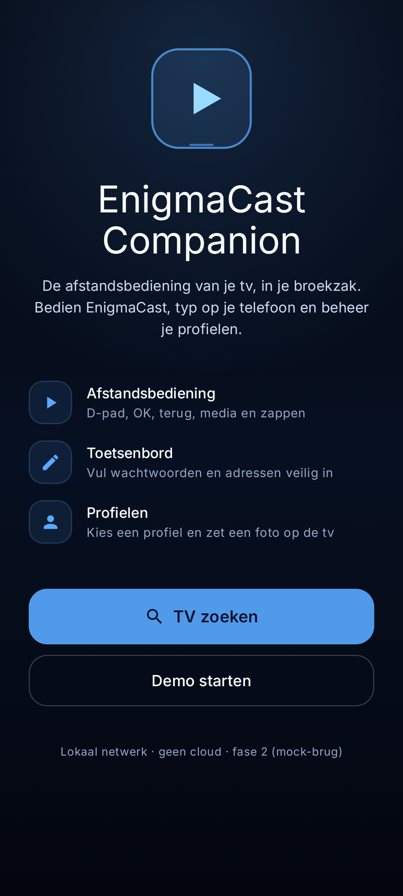
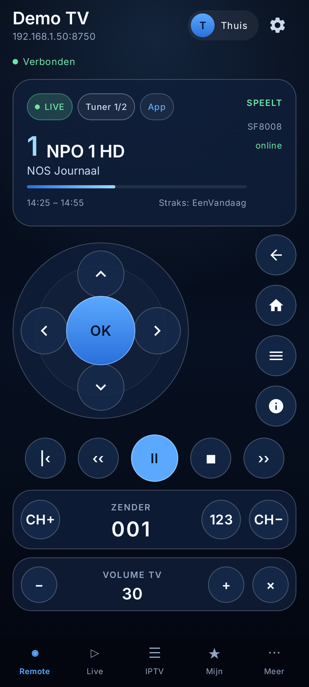

# EnigmaCast Companion — mobiele app

**Versie 1.0.0-beta.12 · build 111.** De app toont dit in **Meer** en **Over deze app**.
Sideload-APK: `dist/enigmacast-companion.apk`; zie
`docs/updates.md`.

De telefoon-app die de EnigmaCast TV-app bedient en zelf live tv en IPTV afspeelt. De
app bevat onboarding, apparaatdetectie (NSD + handmatig adres), koppelen, de volledige
afstandsbediening, tekstinvoer, instellingen, profielbeheer, Live (Enigma2), IPTV
(M3U/Xtream), een speler en de bibliotheek met "verder kijken" en favorieten — tegen de
**echte TV-brug** in EnigmaCast. De mock-brug blijft voor de demo.

De verbinding gebruikt:
- `DeviceIdentity` — ECDSA P-256 in de Android Keystore;
- `PinnedTls` — SPKI-pinning (of TOFU bij een handmatig adres);
- `PairingClient` — `POST /api/v1/pair`;
- `WebSocketConnection` — getekende `wss://…/ws`, hello/state/ack en reconnect met backoff;
- `NsdDiscovery` — `_enigmacast._tcp.` met TXT (`id`, `name`, `app`, `fp`);
- `FormSheet` — verschijnt zodra de TV een tekstveld opent; live `cmd.form` en `SUBMIT`;
- `PhotoUploadClient` — getekende `PUT /api/v1/profiles/{id}/photo` (max 10 MB);
- `SettingsScreen` — 24 instellingen, vijf categorieën, gevarenbevestiging en PIN-prompt;
- `ProfilesScreen` — aanmaken/hernoemen/avatar/verwijderen/foto wissen en "Bekijk foto"
  (getekende `GET`);
- `EnigmaLiveClient` — OpenWebif-lijsten/EPG en stream-URL's (rechtstreeks, geen TV-brug);
- `IptvClient` — M3U-playlist laden en `User-Agent`/`Referer` doorgeven;
- `XtreamClient` — Xtream-login, live/films/series en afleveringen;
- `LibraryStore` — lokale kijkgeschiedenis, favorieten en "verder kijken", plus de
  IPTV-favorieten/posities die de TV via `state.library` deelt;
- `LiveScreen` / `IptvScreen` / `XtreamScreen` / `LibraryScreen` — de fase 5–7-schermen;
- `PlayerScreen` — Media3 ExoPlayer met `PlayerSurface`, play/pause, ster en voortgang.

Nieuwe dependencies: `shared:core-openwebif`, Media3 1.11.1 (`exoplayer`,
`exoplayer-hls`, `ui-compose`). De offline cache vereist
`androidx.exifinterface:exifinterface:1.4.2` (force in `mobile/app/build.gradle.kts`).

Bewezen op twee emulators: koppelen, WSS, `CHANNEL_UP` met 0 ms ack, "1 telefoon(s)
verbonden" op de TV, automatisch herverbinden na een TV-herstart, het TV-zoekveld live
gevuld vanaf de telefoon, instellingen aan/uit, de testfoto op het TV-profiel, een
profiel aanmaken → hernoemen → avatar wijzigen → verwijderen → foto wissen, Live met
zenderlijst/EPG en een spelende stream, M3U- en Xtream-IPTV (live, films en series),
"Verder kijken" + favoriet. De NSD-route op een echt thuisnetwerk staat nog open; de
handmatige route is de fallback.

## Schermen

| Scherm | Status |
|---|---|
| Welkom | klaar |
| TV zoeken (scan) | klaar (mock-resultaten) |
| Koppelen (6-cijferige code) | klaar (demo: `123456`, `000000` wordt geweigerd) |
| Apparaten | klaar (één opgeslagen TV, vergeten, opnieuw zoeken) |
| Afstandsbediening | klaar (D-pad, OK, terug, home, menu, info, transport, zappen, cijfers, volume, mode) |
| Meer/instellingen | klaar (verbinding, trilling, diagnose, 24 TV-instellingen) |
| Profielen | klaar (lezen, wisselen, aanmaken, hernoemen, avatar, verwijderen, foto) |
| Live | klaar (Enigma2-zenderlijst, EPG, recent op de tv, speler; direct, TV niet nodig) |
| IPTV | klaar (M3U, Xtream live/films/series, terugkijken met EPG) |
| Mijn | klaar (verder kijken, favorieten, recent, TV-sync, sync-knop) |




## Architectuur

```text
Compose (Material 3)
   │  AppViewModel (AndroidViewModel, StateFlow/mutableStateOf)
   â–¼
CompanionConnection  ◄── MockBridge (in-process, echt protocol)
   │
   ├─ ProtocolJson / Envelope / KeyCommand / StatePlayerPayload   (shared:core-protocol)
   └─ later: WebSocketClient (WSS + TLS, fase 2 TV-brug)
```

- **Handmatige DI** (`AppContainer`): één verbinding en één store. Geen Hilt in deze fase,
  zodat de build zonder extra plugins blijft werken. Hilt kan later zonder UI-wijzigingen.
- **Geen Navigation-Compose**: `AppScreen` + `when` in `CompanionApp`, net als de TV-app.
- **Geen Room/DataStore** in deze fase: `LocalStore` (SharedPreferences) bewaart de
  gekoppelde TV en de trilfunctie. Fase 4 vervangt dit door DataStore + Keystore.
- **De mock is geen nep-UI**: elk commando gaat als echte `Envelope` met `KeyCommand` naar
  `MockBridge`, die `hello`, `ack`, `state.player`, `state.profiles`, `toast` en `error`
  terugstuurt. Dezelfde DTO's en dezelfde serialisatie als straks de TV-brug.
- **Thema**: de Glass Earth-tokens uit `ui/theme/Skins.kt` van de TV-app, met Inter.

## Bouwen en draaien

```powershell
$env:JAVA_HOME = "C:\Users\user3\.gradle\jdks\eclipse_adoptium-21-amd64-windows.2"
.\gradlew.bat :mobile:app:assembleDebug --offline
.\gradlew.bat :mobile:app:testDebugUnitTest --offline

adb install -r mobile\app\build\outputs\apk\debug\app-debug.apk
adb shell am start -n com.enigmacast.companion/.MainActivity
```

- `minSdk` 26, `compileSdk`/`targetSdk` 37, `buildToolsVersion` 36.1.0 (offline).
- De app is een **telefoon-app**; op een TV-emulator werkt ze ook, maar zonder touch.
- Demo-flow: **Demo starten** op het welkomstscherm, of **TV zoeken → Woonkamer TV →
  123456**.

## Wat de mock simuleert

| Commando | Gedrag |
|---|---|
| `cmd.key` `DPAD_*` | focusindex in de status (enkel zichtbaar in de debugregel) |
| `CHANNEL_UP/DOWN`, `NEXT/PREVIOUS` | volgende/vorige zender uit een vaste lijst |
| `DIGIT_*` | zendernummer opbouwen; na 1,2 s of OK toepassen |
| `PLAY_PAUSE`, `STOP` | pauze/stop, met `state.player` |
| `VOLUME_UP/DOWN`, `MUTE` | volume 0–100 en mute |
| `cmd.zap` | op servicereferentie of nummer |
| `cmd.nav` | toast |
| `cmd.profile` | profiel wisselen en `state.profiles` |
| `cmd.power`, `cmd.sync` | toast |
| `simulateDrop()` | `OFFLINE` → na 2,2 s opnieuw `CONNECTING` → `READY` + nieuwe `hello` |

## Tests

`MockBridge` (10 JVM-tests): 5 voor de mock (koppelen, zappen, `UP`-phase, reconnect,
onbekend commando), 2 voor de reconnect-backoff en 3 voor de TXT-parser.

De echte client en de fase 5–7-schermen zijn end-to-end op twee emulators getest:
koppelen, WSS, `CHANNEL_UP` met 0 ms ack, automatisch herverbinden, het TV-zoekveld live
vullen, instellingen, profiel-CRUD/foto, Live met EPG en een spelende stream, M3U- en
Xtream-IPTV, en "Verder kijken" + favoriet. De decoderketen is met een audiostream
bewezen; video op echte hardware volgt.

## Volgende stap

1. IPTV-films en -series (VOD/series).
2. Kijkgeschiedenis/favorieten tussen TV en telefoon delen.
3. PIN-prompt en `GET`/`DELETE` van foto's.
4. Video op een fysieke ontvanger/provider testen; NSD op een echt netwerk.


